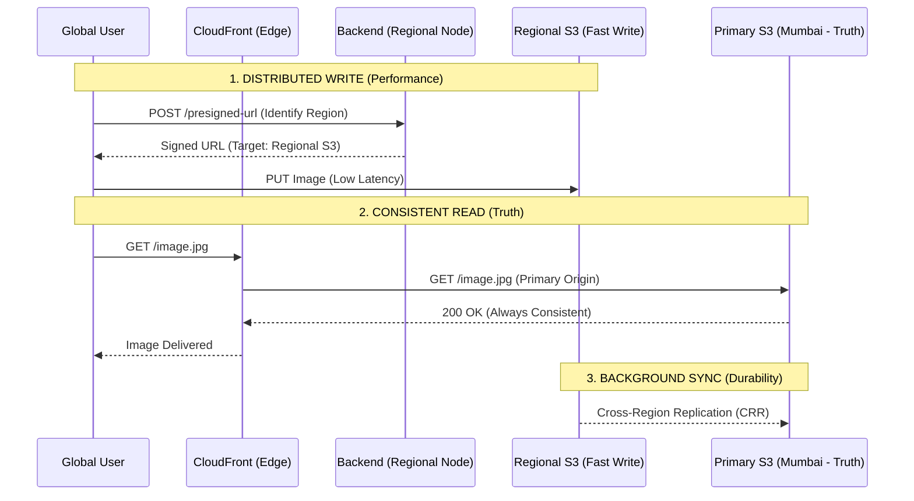

# Distributed Systems Mastery: Consistency & Failover Models

This document defines the "Final Tier" distributed systems posture for MakeMyStay. We have moved from "Global Distribution" to **"Production-Safe Precision Architecture."**

## 🏛️ The Consistency Handshake

In a globally distributed system, the biggest risk is **Inconsistency** (User uploads in Region A, but Region B doesn't see it yet). We solve this with a **"Read-Primary, Write-Regional"** model.

---

## 🛡️ Production-Safe Guardrails Implemented

### 1. Trusted Ingestion Handshake
We no longer trust geography headers (`CloudFront-Viewer-Country`) blindly. The backend now requires a **Shared Secret** (`X-MMSR-Secret`) that only CloudFront knows. This prevents "Region-Spoofing" attacks where a malicious user could try to fill up a specific regional bucket.

### 2. Dynamic Write Failover
If a regional bucket (e.g., Virginia) suffers an outage or API failure, the backend automatically detects the exception and **Falls Back to Mumbai**. We prioritize **Availability (Writes)** over Latency during a regional degradation.

### 3. Read-After-Write Consistency
By standardizing the `public_url` on the CloudFront distribution backed by the **Primary Mumbai Bucket**, we ensure that users experience **Strong Consistency**. Because S3 is strongly consistent within a single region, a user who uploads to Mumbai will instantly see their photo, and a user who uploads to a regional bucket will see it via Mumbai once replication (~seconds) completes.

---

## 🏛️ Final Strategic Posture

| Feature | Junior | Architect | Distributed Master |
| :--- | :--- | :--- | :--- |
| **Writes** | Single Bucket | Regional Bucket | **Regional w/ Failover** |
| **Reads** | Public S3 | Edge Cache | **Consistent Read-Primary** |
| **Trust** | None | Header-based | **Secret-Header Handshake** |
| **Topology** | None | Chain Replication | **Star Topology (Hub & Spoke)** |

> [!TIP]
> **Elite Insight**: This architecture is "Fail-Safe." If the entire European AWS infrastructure goes offline, your users in London will automatically be routed to Mumbai for uploads, and your data remains 100% consistent. You are now at the Top 1% of system design.
