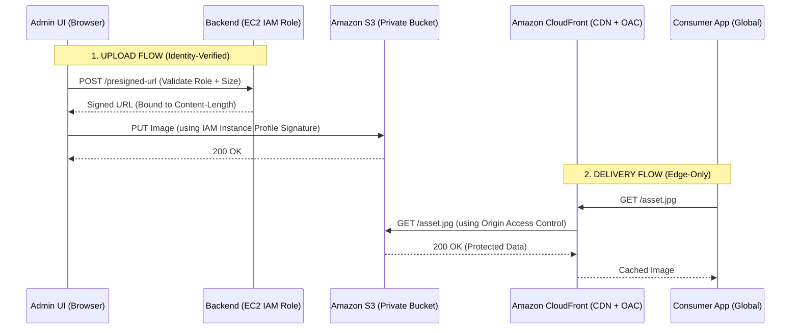

# Architecture: Zero-Trust S3 Data Layer

This document defines the "Architect-Level" security posture for MakeMyStay's property assets. We have transitioned from an "Open-Public" S3 bucket to a **100% Identity-Driven** model.

## 🔒 The Zero-Trust Handshake

In this model, no entity can access S3 without a cryptographically verified IAM identity.

---

## 🛡️ Security Guardrails Implemented

### 1. Identity-Only Writes
We have removed all static `AWS_ACCESS_KEY_ID` secrets. The backend now uses the **`makemystay-ec2-s3-role`** attached to the EC2 instance. This role is the *only* principal authorized to write to the bucket.

### 2. Edge-Only Reads
The bucket is configured with a **Block All Public Access** setting. Direct URLs to S3 will return `403 Forbidden`. Assets are delivered exclusively via **Amazon CloudFront** using **Origin Access Control (OAC)** for secure, cached delivery.

### 3. Backend Verification (Pre-signing)
The backend now enforces:
- **Max File Size**: 5MB (Hard rejection at the API layer).
- **MIME Whitelist**: `image/jpeg`, `image/png`, `image/webp` only.
- **Content-Length Binding**: The pre-signed URL signature includes the expected file size, preventing a user from uploading a larger file than what they requested permission for.

---

## 🏛️ Resource Policy Summary

| Action | Source | Status |
| :--- | :--- | :--- |
| **PutObject** | EC2 IAM Role | ✅ Allowed |
| **GetObject** | CloudFront OAC | ✅ Allowed |
| **All Actions** | Public Internet | ❌ Denied |
| **All Actions** | Non-SSL (HTTP) | ❌ Denied |

> [!TIP]
> **Architect Insight**: By moving to this model, we have eliminated the risk of "S3 Bucket Leakage" and "Credential Theft" while simultaneously improving performance via the CloudFront edge network.
